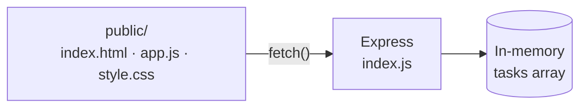

<div align="center">

# ✅ Node.js CRUD API

**A clean task API built with Express, plus a plain HTML/JS front end that talks to it.**


</div>

---

## 📌 About

Written to practise the **full set of CRUD routes end to end**: routing, validation, status codes and error handling, with a small UI to try them without Postman.

Tasks are kept **in memory**, so the list resets when the server restarts. That's deliberate: the focus is on the API design and request handling, not the database.

---

## 🔁 How it fits together



---

## 🛣️ Endpoints

| Method | Path | What it does | Responses |
|---|---|---|---|
| `GET` | `/api` | Lists the available endpoints | 200 |
| `GET` | `/tasks` | Every task | 200 |
| `GET` | `/tasks/:id` | One task | 200 · 400 bad id · 404 |
| `POST` | `/tasks` | Create a task | 201 · 400 invalid body |
| `PUT` | `/tasks/:id` | Update a task | 200 · 400 · 404 |
| `DELETE` | `/tasks/:id` | Remove a task | 200 · 400 · 404 |

### A task

```json
{
  "id": 1,
  "title": "Learn Express basics",
  "description": "Create a simple CRUD API",
  "status": "pending",
  "createdAt": "2025-12-16T00:00:00.000Z",
  "updatedAt": "2025-12-16T00:00:00.000Z"
}
```

---

## 🚀 Run it

```bash
npm install
npm run dev
```

Open **http://localhost:3000** for the front end, or call the API directly. Set `PORT` to use a different port.

### Try it with curl

```bash
curl http://localhost:3000/tasks
curl -X POST http://localhost:3000/tasks -H "Content-Type: application/json" -d '{"title":"Write tests","description":"Cover the error paths"}'
curl -X PUT http://localhost:3000/tasks/1 -H "Content-Type: application/json" -d '{"status":"done"}'
curl -X DELETE http://localhost:3000/tasks/1
```

---

## 📁 Project layout

```
index.js     the server and all routes
public/      the front end: index.html, app.js, style.css
```

## 🧭 Next steps

- [ ] Persist tasks in MongoDB or SQLite
- [ ] Request validation with a schema
- [ ] Automated tests for every route

---

<div align="center">

Made by **[Muhammad Muzamil](https://github.com/muzamil112a)** · Also see **[Orbitool](https://github.com/muzamil112a/orbitool)**

</div>
